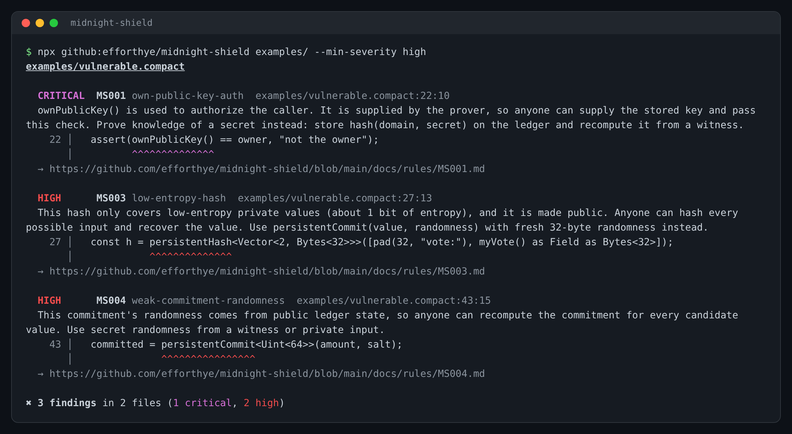
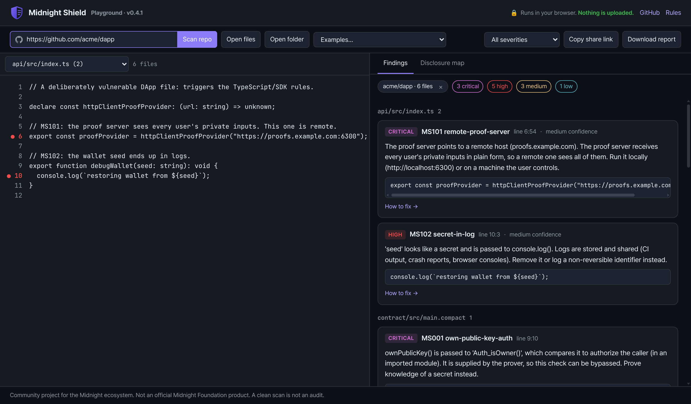
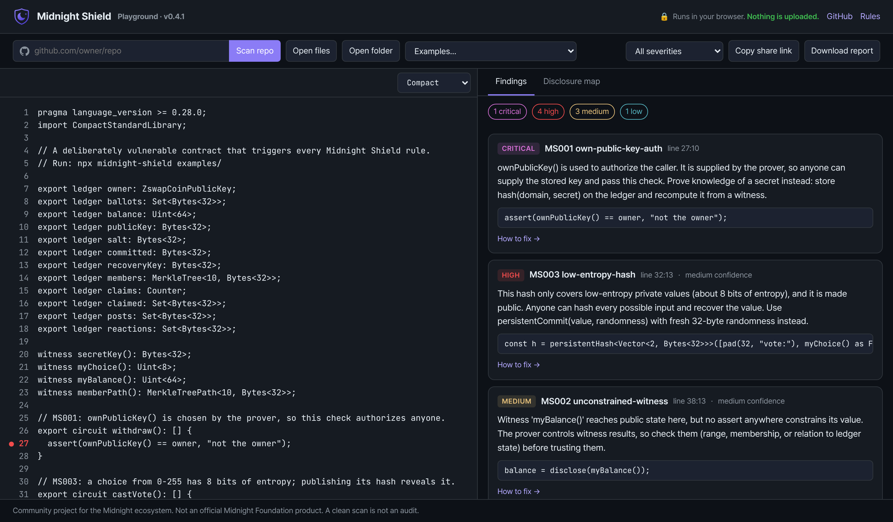
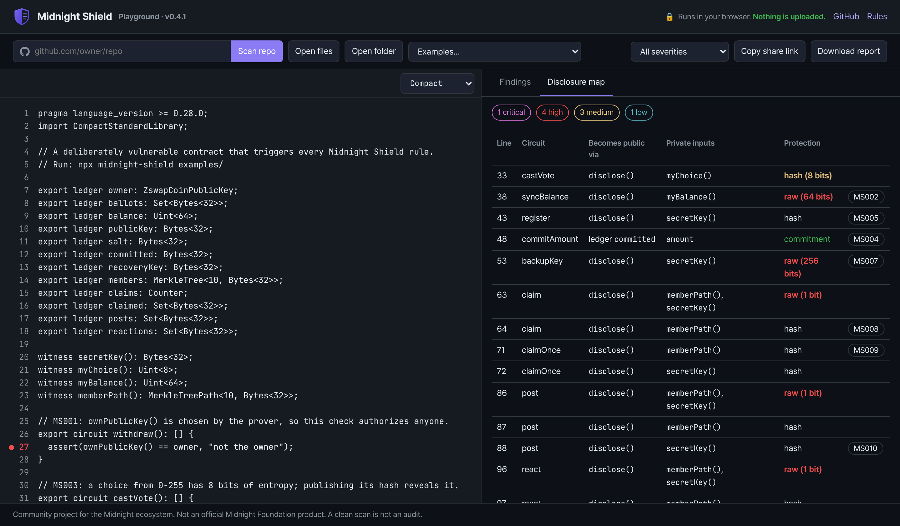
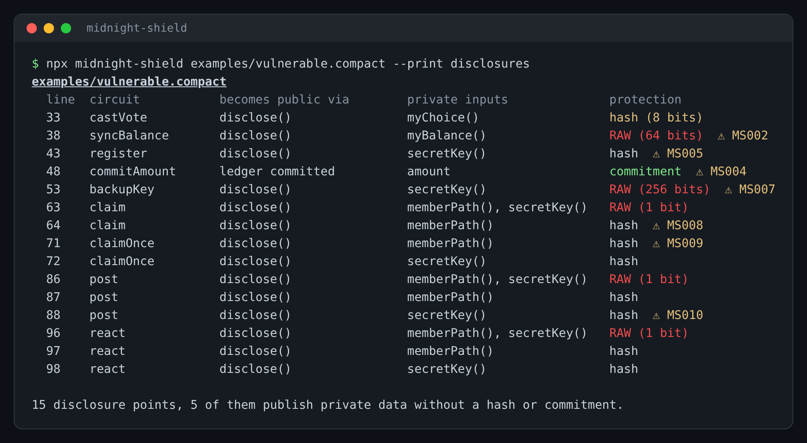
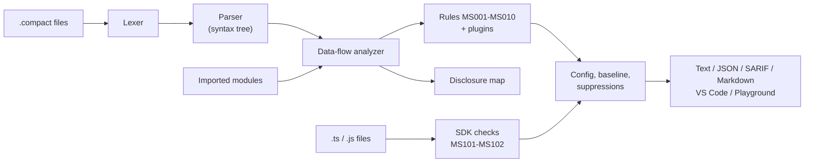
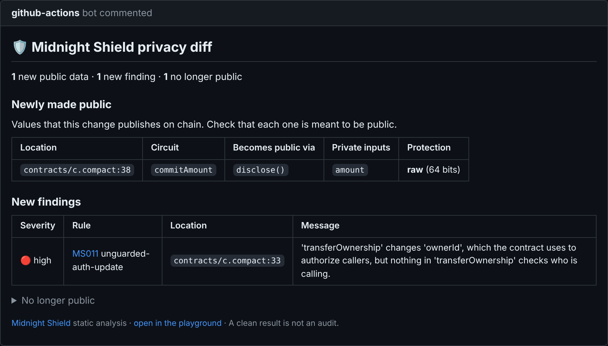
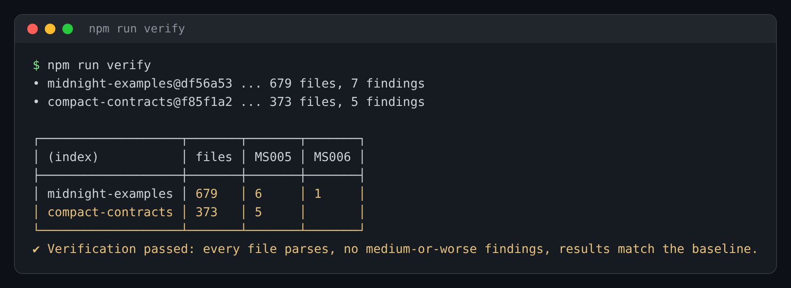

<div align="center">


# Midnight Shield

**Static analyzer for Midnight Compact contracts and the TypeScript code around them.**
Catch security and privacy bugs before you deploy: in your terminal, your editor, your browser, CI, and AI coding agents.

[](https://github.com/efforthye/midnight-shield/actions/workflows/ci.yml)
[](LICENSE)


-96%25-brightgreen)
[](https://www.npmjs.com/package/midnight-shield)

[Quick start](#quick-start) · [Web playground](#web-playground) · [Rules](#rules) · [Disclosure map](#disclosure-map) · [Editor](#vs-code) · [CI](#github-action) · [AI agents](#use-with-ai-coding-agents) · [Verification](#testing-and-verification) · [Pitch deck](#presentation)



**[▶ Try it in your browser](https://efforthye.github.io/midnight-shield/)** · no install, your code never leaves the page

<sub>Community project for the Midnight ecosystem. Not an official Midnight Foundation product.</sub>

</div>

---

## What's new

- 🔁 **[Privacy diff on pull requests](#privacy-diff)**: the GitHub Action comments what a change newly makes public, and which findings it adds or fixes.
- 🏷️ **[Status badge](#status-badge)** for your README: `verified` when clean, otherwise the number of findings in red, orange or yellow.
- 🩹 **[Suggested fixes](#3-fix-and-scan-again)**: every finding shows the flagged line rewritten, as a diff you can copy.
- 🧩 **[3 new rules](#rules)**: [MS011](docs/rules/MS011.md) owner change without a caller check, [MS103](docs/rules/MS103.md) seed in the source, [MS104](docs/rules/MS104.md) private state in `localStorage`.
- 🌐 **[Scan a whole repository](#web-playground)** in the playground, or open a local folder.

## Why Midnight Shield?

The Compact compiler already stops you from disclosing witness data by accident. But a contract can **compile cleanly and still leak or be exploitable**:

| Bug | What goes wrong | Rule |
| --- | --- | --- |
| "Owner" check with `ownPublicKey()` | The prover supplies that value, so anyone can pass the check | [MS001](docs/rules/MS001.md) |
| Unchecked witness | The user can write any balance, score, or state to the ledger | [MS002](docs/rules/MS002.md) |
| Public hash of a vote, age, or PIN | Few possible inputs, so the hash can be brute-forced | [MS003](docs/rules/MS003.md) |
| Commitment with public or reused randomness | The commitment hides nothing, or links users together | [MS004](docs/rules/MS004.md) |
| `disclose(secretKey())` | The secret key is published for everyone to read | [MS007](docs/rules/MS007.md) |
| Merkle membership with no nullifier | One member can vote or claim again and again | [MS008](docs/rules/MS008.md) |
| Merkle root checked, leaf never checked | Anyone can reuse another member's public path | [MS009](docs/rules/MS009.md) |
| Same member tag in every circuit | Anonymous members' actions can be linked together | [MS010](docs/rules/MS010.md) |
| Remote proof server in the DApp | A third party sees every user's private inputs | [MS101](docs/rules/MS101.md) |
| Owner change with no caller check | Anyone can make themselves the owner or an admin | [MS011](docs/rules/MS011.md) |
| Wallet seed in a log | The seed ends up in CI logs and crash reports | [MS102](docs/rules/MS102.md) |
| Wallet seed in the source | Anyone who reads the repo or the web bundle can use it | [MS103](docs/rules/MS103.md) |
| Private state in `localStorage` | Any script on the page can read users' private data | [MS104](docs/rules/MS104.md) |

Midnight Shield is to Midnight what **Slither** is to Solidity and **aztec-lint** is to Noir: a static analyzer that catches issues before deploy, with rules built around Midnight's privacy model.

## Highlights

- 🔍 **Real parser and data-flow analysis.** Tracks every value back to witnesses, private inputs, public ledger state, or constants, across helper circuits and imported files.
- 🗺️ **Disclosure map.** One table of everything your contract makes public, and whether it is raw, hashed or committed. Unique to Midnight.
- 🎲 **Entropy-aware.** Knows a `Boolean` vote has 1 bit of secret entropy and a `Bytes<32>` key has 256, so it flags brute-forceable hashes without crying wolf.
- 🎯 **Honest about certainty.** Every finding has a severity *and* a confidence. Rules that rely on names or guess intent say so.
- 🧪 **Verified on real code, in CI.** 1,052 files of the official examples and OpenZeppelin Contracts for Compact (Compact and TypeScript) at pinned commits: zero parse errors, and every medium-or-worse finding reviewed by hand. Examples are compiled with the real Compact compiler.
- 🔁 **Privacy diff on every pull request.** The GitHub Action comments what a change newly makes public and which findings it adds or fixes, before it is merged.
- 🩹 **Suggested fixes.** Each finding comes with the flagged line rewritten, as a diff you can copy.
- 🧰 **Everywhere you work.** CLI, web playground, VS Code, GitHub Action with SARIF, Markdown reports, Claude Code skill, plugin API.
- 🏗️ **Easy to adopt.** Baselines accept existing findings so CI only fails on new ones. Zero runtime dependencies.

## Quick start

Requires Node.js 20 or later.

```bash
# run once, no install
npx midnight-shield contracts/

# or add it to your project
npm install --save-dev midnight-shield
npx midnight-shield contracts/

# or install globally
npm install -g midnight-shield
midnight-shield contracts/
```

Not ready to install anything? Scan your GitHub repository or paste a contract in the **[web playground](#web-playground)**.

The repository has examples: [`examples/vulnerable.compact`](examples/vulnerable.compact) triggers every Compact rule, [`examples/dapp/vulnerable.ts`](examples/dapp/vulnerable.ts) every TypeScript rule, and the `safe` versions show the fixes (0 findings).

## Web playground

**[efforthye.github.io/midnight-shield](https://efforthye.github.io/midnight-shield/)**

The full analyzer, compiled to run in the browser. Check your own project in three ways:

| | How | What happens |
| --- | --- | --- |
| **Scan a GitHub repo** | Enter `github.com/owner/repo` (or a `…/tree/<branch>/<folder>` link) and press **Scan repo** | Your browser downloads the repository's `.compact` and DApp TypeScript files straight from GitHub and analyzes them together, with imports resolved |
| **Open files or a folder** | **Open files**, **Open folder**, or drag and drop | Files are read locally. Nothing is uploaded |
| **Paste code** | Type or paste into the editor | Findings update as you type |

There is no server: the page is static, and your code stays in your browser. Public repositories only.



| Findings with fixes | Disclosure map |
| --- | --- |
|  |  |

- **Suggested fixes** under each finding, as a diff with a **Copy fix** button
- **Whole-project results** grouped by file. Click a finding to open that file at the line
- **Disclosure map** tab: every value that becomes public, and whether it is raw, hashed or committed
- **Share link**: a repository scan is shared as `…/#repo=owner/repo`, so anyone can rerun it; pasted code is stored in the link itself
- **Download report** as Markdown for an audit note or a PR comment
- Examples, severity filter, light and dark themes, and a mobile layout

Show your project's status in its README with a badge that updates on every push (set up in the [GitHub Action](#status-badge)). It looks like  or  and opens the scan in the playground when clicked.

To run it locally: `npm run playground` builds a single file at `playground/dist/index.html` that you can open directly.

## Usage guide

### 1. Scan

```bash
npx midnight-shield contracts/          # .compact files and the DApp's .ts/.js files
npx midnight-shield contracts/ --no-sdk # only .compact files
```

Midnight Shield skips `node_modules`, `dist`, `build`, compiler output and, for TypeScript checks, test files. It follows `import "..."` into other Compact files.

### 2. Read a finding

Each finding shows its **severity**, **rule**, **location** (clickable in most terminals), **confidence** when it is not high, the **message** with the fix, a **code frame**, and a link to the rule page.

```bash
npx midnight-shield explain MS009   # read a rule's documentation in the terminal
```

### 3. Fix and scan again

Each finding shows a **suggested fix**: the flagged line rewritten, as a diff. Names only you can choose (a domain tag, a witness) appear as placeholders such as `myapp`. Every rule page also shows a vulnerable and a fixed example.

```text
  Suggested fix
    - committed = persistentCommit<Uint<64>>(amount, salt);
    + committed = persistentCommit<Uint<64>>(amount, randomness());
```

Safe fixes can be applied automatically:

```bash
npx midnight-shield contracts/ --fix-dry-run   # see what would change
npx midnight-shield contracts/ --fix           # apply
```

Only fixes that cannot change what a contract does are automatic (today: adding a missing `pragma`). Fixes that change hashes or commitments would change on-chain values, so they are left to you or to the [AI skill](#use-with-ai-coding-agents).


### 4. Adopt it in an existing project

Accept today's findings and fail CI only on new ones:

```bash
npx midnight-shield contracts/ --write-baseline .midnight-shield-baseline.json
npx midnight-shield contracts/ --baseline .midnight-shield-baseline.json
```

Baseline entries are matched by a fingerprint of the rule and the code line, so moving code around does not break them. `--show-suppressed` lists everything that is hidden by a baseline or an inline comment, for audits.

### 5. Configure

```bash
npx midnight-shield --init   # creates midnight-shield.config.json
```

```json
{
  "disable": [],
  "failOn": "high",
  "minSeverity": "info",
  "minConfidence": "low",
  "ignore": ["**/test/**"],
  "baseline": ".midnight-shield-baseline.json",
  "plugins": ["./tools/our-rules.mjs"],
  "sdk": true
}
```

To silence one finding in code, say why next to it:

```compact
// shield-disable-next-line MS005 -- the tag is supplied by every caller
const h = persistentHash<Vector<2, Bytes<32>>>([tag, sk]);
```

`shield-disable-line` and `shield-disable-file` work the same way. Leave out the rule ID to suppress every rule.

### 6. Report

```bash
npx midnight-shield contracts/ --format markdown -o report.md   # audit or PR report
npx midnight-shield contracts/ --format sarif -o results.sarif  # GitHub code scanning
npx midnight-shield contracts/ --format json                    # scripts and AI agents
```

## Rules


**Compact contracts**

| ID | Name | Severity | Confidence | Finds |
| --- | --- | --- | --- | --- |
| [MS001](docs/rules/MS001.md) | `own-public-key-auth` | 🟣 Critical | high | `ownPublicKey()` compared to a key to authorize the caller, including through helper circuits |
| [MS002](docs/rules/MS002.md) | `unconstrained-witness` | 🟡 Medium | medium | A witness value reaches public state with no `assert` that checks it |
| [MS003](docs/rules/MS003.md) | `low-entropy-hash` | 🔴 High | medium | A hash of only low-entropy private values (vote, age, PIN) made public |
| [MS004](docs/rules/MS004.md) | `weak-commitment-randomness` | 🔴 High | high | A commitment with constant, public, short, or reused randomness |
| [MS005](docs/rules/MS005.md) | `missing-domain-separation` | 🔵 Low | medium | A hash of private data with no constant domain tag |
| [MS006](docs/rules/MS006.md) | `missing-pragma` | ⚪ Info | high | No `pragma language_version` (auto-fixable) |
| [MS007](docs/rules/MS007.md) | `disclosed-secret` | 🔴 High | low | The raw value of a secret key, seed, or password is made public |
| [MS008](docs/rules/MS008.md) | `missing-nullifier` | 🟡 Medium | low | Merkle-authorized state change with no nullifier, so it can be repeated |
| [MS009](docs/rules/MS009.md) | `unbound-merkle-path` | 🔴 High | high | Merkle root checked, but the path's leaf is never tied to the caller |
| [MS010](docs/rules/MS010.md) | `linkable-ledger-update` | 🟡 Medium | medium | In an anonymous-membership contract, the same secret-derived tag is published by several circuits |
| [MS011](docs/rules/MS011.md) | `unguarded-auth-update` | 🔴 High | medium | An exported circuit changes an owner key or admin set without checking the caller |

**DApp code (TypeScript / JavaScript)**

| ID | Name | Severity | Confidence | Finds |
| --- | --- | --- | --- | --- |
| [MS101](docs/rules/MS101.md) | `remote-proof-server` | 🟣 Critical | medium | The proof server URL points to a remote host |
| [MS102](docs/rules/MS102.md) | `secret-in-log` | 🔴 High | medium | A seed, secret key or password passed to a log call |
| [MS103](docs/rules/MS103.md) | `hardcoded-secret` | 🟣 Critical | medium | A seed, secret key or recovery phrase written into the source |
| [MS104](docs/rules/MS104.md) | `private-state-in-browser-storage` | 🔴 High | medium | Private state or a secret saved to `localStorage` / `sessionStorage` |

Need a rule for your own conventions? [Write a plugin](docs/custom-rules.md).

## Disclosure map

On Midnight, everything that becomes public is explicit. The disclosure map lists all of it in one place, so a reviewer can check the privacy of a contract in minutes:

```bash
npx midnight-shield contracts/ --print disclosures
```



`RAW` means private data is published as is. That is sometimes intended (a public balance), but every `RAW` row deserves a second look. The map is also available as JSON and Markdown (`--format json|markdown`), in the playground, and in VS Code.

## How it works



For every circuit, the analyzer evaluates each expression to a summary of where its value came from:

| Source | Example | Treated as |
| --- | --- | --- |
| Witness | `secretKey()` | Private, prover-controlled |
| Circuit parameter | `amount: Uint<64>` | Private |
| Ledger state | `owner`, `balances.lookup(k)` | Public |
| Constant | `pad(32, "app:")`, `default<Bytes<32>>`, enum members | Public, zero entropy |
| `disclose(x)` | | Public from this point on |

Secret entropy is estimated from types (`Boolean` = 1 bit, `Uint<16>` = 16, `Bytes<32>` = 256). Calls to circuits in the same file or in imported modules are evaluated with the caller's arguments, so a check hidden in a helper is still found.

The rules follow the [Midnight security best practices](https://docs.midnight.network/guides/security-best-practices) and the [explicit disclosure](https://docs.midnight.network/compact/explicit_disclosure) rules.

## VS Code

The extension in [`vscode/`](vscode) shows findings as you type, with links to each rule, a **Scan workspace** command and a **Show disclosure map** command. It reads `midnight-shield.config.json` and inline suppressions. See [`vscode/README.md`](vscode/README.md) to build and install it.

## GitHub Action

```yaml
# .github/workflows/midnight-shield.yml
name: Midnight Shield
on:
  push:
    branches: [main]
  pull_request:

jobs:
  scan:
    runs-on: ubuntu-latest
    permissions:
      contents: write        # publish the status badge (or read without badge: true)
      pull-requests: write   # comment the privacy diff
      security-events: write # show results in the Security tab
    steps:
      - uses: actions/checkout@v4
      - uses: efforthye/midnight-shield@main
        with:
          path: contracts
          fail-on: high
          badge: true
```

What it does:

- **Every run:** scans, fails the job at `fail-on`, and puts findings in **Security → Code scanning** and as annotations on pull requests.
- **Pull requests:** comments a **privacy diff** and keeps that one comment up to date as you push.
- **Pushes to the default branch** (with `badge: true`): updates the status badge.

### Privacy diff

On a pull request, Midnight Shield scans both the base and the change, and comments what the change does to privacy:



Lines that only moved are not reported. A protection that gets weaker (commitment → hash → raw) is marked ⚠️. The same diff works locally:

```bash
npx midnight-shield snapshot contracts -o base.json   # on main
npx midnight-shield snapshot contracts -o head.json   # on your branch
npx midnight-shield diff base.json head.json          # --format markdown|json, --fail-on high
```

### Status badge

With `badge: true`, each push to the default branch writes the result to a `midnight-shield-badge` branch. Add the badge to your README (replace `OWNER/REPO`):

```markdown
[](https://efforthye.github.io/midnight-shield/#repo=OWNER/REPO)
```

It shows  when the scan is clean. Otherwise it shows the number of the most severe findings: red for critical or high, such as , orange for medium, such as , and yellow for low, such as . "Verified" means the code passes every Midnight Shield check, not that it was audited. `--badge badge.json` writes the same file from the CLI.

| Input | Default | Description |
| --- | --- | --- |
| `path` | `.` | Files or folders to scan |
| `fail-on` | `high` | Fail the job at or above this severity (`none` to never fail) |
| `upload-sarif` | `true` | Upload results to GitHub code scanning |
| `pr-comment` | `true` | Comment the privacy diff on pull requests |
| `badge` | `false` | Publish the status badge on pushes to the default branch |

## Use with AI coding agents

### Claude Code skill

[`skills/midnight-shield`](skills/midnight-shield/SKILL.md) teaches Claude Code to scan, fix findings in order of severity, check the disclosure map, and re-scan until the contract is clean:

```bash
mkdir -p .claude/skills
cp -r node_modules/midnight-shield/skills/midnight-shield .claude/skills/
```

### JSON and the library API

```bash
npx midnight-shield contracts/ --format json --fail-on none
```

```ts
import { lintSource, mapDisclosures } from "midnight-shield";

const findings = lintSource(source, "counter.compact");
const publicData = mapDisclosures(source, "counter.compact");
```

## CLI reference

```text
midnight-shield [paths...] [options]
midnight-shield explain <RULE>
midnight-shield snapshot [paths...] -o snapshot.json
midnight-shield diff <base.json> <head.json>
midnight-shield --init

Output:     -f, --format text|json|sarif|markdown   -o, --output <file>
            --print disclosures   --badge <file>   --no-code-frame   --no-suggestions   --no-color
Filtering:  --fail-on <severity>  --min-severity <severity>  --min-confidence <confidence>
            --disable <IDs>  --ignore <glob>  --no-sdk  --show-suppressed
Adoption:   --baseline <file>  --write-baseline <file>  --fix  --fix-dry-run
            -c, --config <file>  --plugin <module>
Other:      --list-rules  -v, --version  -h, --help
```

Exit codes: `0` no blocking findings, `1` findings at or above `--fail-on`, `2` usage or config error.

## Where it fits

Midnight Shield works alongside the tools you already use. Each does a different job:

| Tool | What it does | Use it for |
| --- | --- | --- |
| Compact compiler | Checks types and makes every disclosure of private data explicit | Writing correct contracts. Always required |
| [Night Check](https://github.com/CjDabrow/night-check) | Fast pattern checks for Compact and DApp code, with a web UI that records reviews on chain | Quick checks and a public record of a review |
| **Midnight Shield** | Data-flow analysis built around Midnight's privacy model: the disclosure map, entropy-aware hash checks, suggested fixes and a privacy diff on pull requests | Catching privacy and security bugs before deploy, in your editor, in CI and with AI agents |

On other chains, the same role is played by [Slither](https://github.com/crytic/slither) for Solidity and aztec-lint for Noir.

## Testing and verification

| Check | What it proves | Command |
| --- | --- | --- |
| **Unit and integration tests** (148 tests) | Lexer, parser, every rule (flagged and not-flagged cases), suggested fixes, privacy diff, badge, reporters, CLI, baselines, plugins | `npm test`, `npm run coverage` |
| **Fuzz tests** | Random token edits, truncations, random bytes, deep nesting and recursive circuits never crash the analyzer | part of `npm test` |
| **Corpus verification** | 1,052 real files (Compact and TypeScript) at pinned commits: zero parse errors, results match a reviewed baseline, and every medium-or-worse finding is a confirmed one listed in [`verify/reviewed.json`](verify/reviewed.json) | `npm run verify` |
| **Real compiler** | The example contracts compile with the official `compact` toolchain | CI job `compile-examples` |
| **Package** | The npm tarball installs and the CLI runs | CI job `package` |



## Roadmap

- [x] **v0.1** Parser, data-flow analysis, CLI, GitHub Action, SARIF
- [x] **v0.2** Imported modules, code frames, config file, Claude Code skill
- [x] **v0.3** Merkle and secret rules, corpus verification, real-compiler CI
- [x] **v0.4** Disclosure map, confidence, baselines, Markdown, plugins, autofix, TypeScript checks, playground, VS Code extension, npm package
- [x] **v0.5** Repository and folder scanning in the playground, project logo, GitHub Packages
- [x] **Next** Privacy diff on pull requests, status badge, suggested fixes, MS011 / MS103 / MS104
- [ ] VS Code Marketplace release
- [ ] Data-flow facts for plugins
- [ ] More rules from community feedback

Ideas and false-positive reports are welcome in [Issues](https://github.com/efforthye/midnight-shield/issues).

## Development

```bash
npm install
npm test            # build + tests
npm run coverage    # tests with coverage
npm run verify      # scan real Midnight code and compare with the baseline
npm run playground  # build the web playground into playground/dist
npm run demo        # scan examples/
```

See [CONTRIBUTING.md](CONTRIBUTING.md), [SECURITY.md](SECURITY.md) and [CHANGELOG.md](CHANGELOG.md).

## Presentation

The pitch deck from KR NightForce Cohort 2: the problem, the solution, how it compares and how it was verified.

- [Slides (PDF)](presentation/midnight-shield-pitch.pdf)
- [Slides with the speaker script in English and Korean (PDF)](presentation/midnight-shield-pitch-with-script.pdf)

## Acknowledgements

Several initial rule ideas come from [Night Check](https://github.com/CjDabrow/night-check) (MIT). Feature ideas from [Slither](https://github.com/crytic/slither), [Aderyn](https://github.com/Cyfrin/aderyn), [Circomspect](https://github.com/trailofbits/circomspect) and aztec-lint. Built as part of **KR NightForce Cohort 2** (Builder track).

## License

[MIT](LICENSE)
