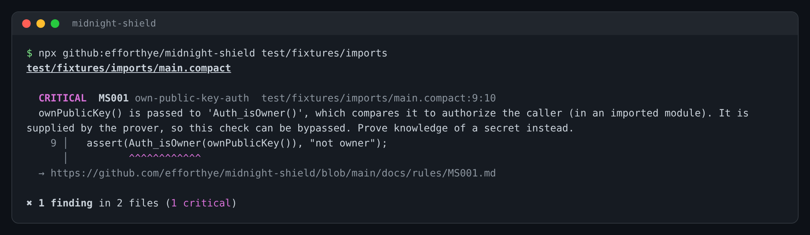
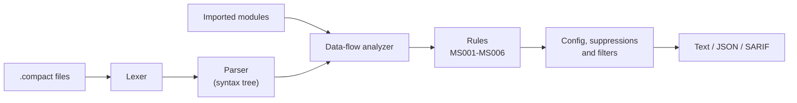
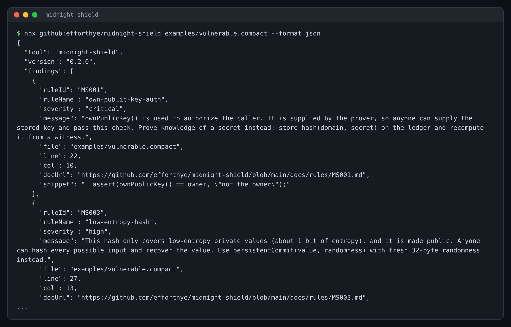

<div align="center">

# 🛡️ Midnight Shield

**Static analyzer for Midnight Compact contracts.**
Catch security and privacy bugs before you deploy, in your terminal, in CI, and in AI coding agents.

[](https://github.com/efforthye/midnight-shield/actions/workflows/ci.yml)
[](LICENSE)


[Quick start](#quick-start) · [Usage guide](#usage-guide) · [Rules](#rules) · [How it works](#how-it-works) · [GitHub Action](#github-action) · [AI agents](#use-with-ai-coding-agents)


</div>

---

## Why Midnight Shield?

The Compact compiler already stops you from disclosing witness data by accident. But a contract can **compile cleanly and still leak or be exploitable**:

| Bug | What goes wrong | Rule |
| --- | --- | --- |
| "Owner" check with `ownPublicKey()` | The prover supplies that value, so anyone can pass the check | [MS001](docs/rules/MS001.md) |
| Unchecked witness | The user can write any balance, score, or state to the ledger | [MS002](docs/rules/MS002.md) |
| Public hash of a vote, age, or PIN | Few possible inputs, so the hash can be brute-forced | [MS003](docs/rules/MS003.md) |
| Commitment with public or reused randomness | The commitment hides nothing, or links users together | [MS004](docs/rules/MS004.md) |
| Hash without a domain tag | The same secret produces linkable outputs across uses | [MS005](docs/rules/MS005.md) |

Midnight Shield is to Midnight what **Slither** is to Solidity and **aztec-lint** is to Noir: a static analyzer that catches issues before deploy, with rules built around Midnight's privacy model.

## Highlights

- 🔍 **Real parser, not regex.** Compact is parsed into a syntax tree, and one unsupported construct never hides the rest of the file.
- 🧬 **Data-flow analysis across circuits and files.** Tracks every value back to witnesses, private inputs, public ledger state, or constants, and follows calls into helper circuits and imported modules.
- 🎲 **Entropy-aware.** Knows that a `Boolean` vote has 1 bit of secret entropy and a `Bytes<32>` key has 256, so it flags brute-forceable hashes without crying wolf.
- 🧪 **Tested on real code.** All 146 `.compact` files in the official examples and OpenZeppelin Contracts for Compact parse cleanly, with zero critical, high, or medium findings.
- 🤖 **Built for AI-assisted development.** JSON output and a ready-made agent skill let Claude Code scan, fix, and re-scan on its own.
- ⚙️ **Fits your workflow.** Code frames in the terminal, SARIF for GitHub code scanning, a config file, inline suppressions, and zero runtime dependencies.

## Quick start

Requires Node.js 20 or later. No install needed:

```bash
npx github:efforthye/midnight-shield contracts/
```

Or try it on the bundled examples:

```bash
git clone https://github.com/efforthye/midnight-shield.git
cd midnight-shield
npm install
npm run demo
```

[`examples/vulnerable.compact`](examples/vulnerable.compact) triggers every rule. [`examples/safe.compact`](examples/safe.compact) is the same logic written safely.

## Usage guide

### 1. Scan your contracts

Point Midnight Shield at a file or a folder. It finds every `.compact` file inside (skipping `node_modules`, `dist`, `build` and compiler output), and follows `import "..."` statements into other files.

```bash
npx github:efforthye/midnight-shield contracts/
```

### 2. Read a finding


Each finding shows:

| Part | Example | Meaning |
| --- | --- | --- |
| Severity | `CRITICAL` | How bad it is: critical, high, medium, low, info |
| Rule | `MS001 own-public-key-auth` | Which check fired |
| Location | `examples/vulnerable.compact:22:10` | File, line, column. Click it in most terminals and editors |
| Message | `ownPublicKey() is used to...` | What is wrong and how to fix it |
| Code frame | `^^^^^^^^^^^^^^` | The exact expression |
| Link | `→ .../docs/rules/MS001.md` | Full explanation with a vulnerable and a fixed example |

### 3. Fix and scan again

Every rule page has a fix. For MS001, authorize with a secret instead of `ownPublicKey()`:

```diff
- export ledger owner: ZswapCoinPublicKey;
+ export ledger ownerId: Bytes<32>;
+ witness secretKey(): Bytes<32>;
+
+ circuit deriveId(sk: Bytes<32>): Bytes<32> {
+   return persistentHash<Vector<2, Bytes<32>>>([pad(32, "myapp:owner:"), sk]);
+ }

  export circuit withdraw(): [] {
-   assert(ownPublicKey() == owner, "not the owner");
+   assert(deriveId(secretKey()) == ownerId, "not the owner");
  }
```

Then run the scan again until it is clean:


### 4. Follow imports across files

Checks hidden in imported modules are followed, and findings are reported where your code calls them:



### 5. Tune it for your project

Create a config file, then edit it:

```bash
npx github:efforthye/midnight-shield --init
```

For example, to fail CI on high or worse and skip test contracts:

```json
{
  "disable": [],
  "failOn": "high",
  "minSeverity": "info",
  "ignore": ["**/test/**"]
}
```

| Key | Default | Description |
| --- | --- | --- |
| `disable` | `[]` | Rule IDs to skip, e.g. `["MS005"]` |
| `failOn` | `"high"` | Exit with code 1 at or above this severity (`"none"` to never fail) |
| `minSeverity` | `"info"` | Hide findings below this severity |
| `ignore` | `[]` | Glob patterns of files to skip |

`midnight-shield.config.json` in the working directory is loaded automatically. Command-line options override it.

To silence one finding in code, say why next to it:

```compact
// shield-disable-next-line MS005 -- the tag is supplied by every caller
const h = persistentHash<Vector<2, Bytes<32>>>([tag, sk]);

const y = persistentHash<Bytes<32>>(z); // shield-disable-line MS005

// shield-disable-file MS006   (anywhere in the file)
```

Leave out the rule ID to suppress every rule on that line.

### 6. Add it to CI

See [GitHub Action](#github-action) below. Findings show up in the Security tab and on pull requests.

## Rules


| ID | Name | Severity | Finds |
| --- | --- | --- | --- |
| [MS001](docs/rules/MS001.md) | `own-public-key-auth` | 🟣 Critical | `ownPublicKey()` compared to a key to authorize the caller, including through helper circuits |
| [MS002](docs/rules/MS002.md) | `unconstrained-witness` | 🟡 Medium | A witness value reaches public state with no `assert` that checks it |
| [MS003](docs/rules/MS003.md) | `low-entropy-hash` | 🔴 High | A hash of only low-entropy private values (vote, age, PIN) made public |
| [MS004](docs/rules/MS004.md) | `weak-commitment-randomness` | 🔴 High | A commitment with constant, public, short, or reused randomness |
| [MS005](docs/rules/MS005.md) | `missing-domain-separation` | 🔵 Low | A hash of private data with no constant domain tag |
| [MS006](docs/rules/MS006.md) | `missing-pragma` | ⚪ Info | No `pragma language_version` |

Every rule page explains why it matters, shows a vulnerable and a fixed example, and lists what is deliberately **not** flagged.

## How it works



For every circuit, the analyzer evaluates each expression to a summary of where its value came from:

| Source | Example | Treated as |
| --- | --- | --- |
| Witness | `secretKey()` | Private, prover-controlled |
| Circuit parameter | `amount: Uint<64>` | Private |
| Ledger state | `owner`, `balances.lookup(k)` | Public |
| Constant | `pad(32, "app:")`, `default<Bytes<32>>`, enum members | Public, zero entropy |
| `disclose(x)` | | Public from this point on |

Secret entropy is estimated from types (`Boolean` = 1 bit, `Uint<16>` = 16, `Bytes<32>` = 256). Calls to circuits in the same file or in imported modules are evaluated with the caller's arguments, so a check hidden in a helper is still found, and a domain tag passed in by the caller is still seen.

## CLI reference

```text
midnight-shield [paths...] [options]
midnight-shield --init

  -f, --format <text|json|sarif>   Output format (default: text)
  -o, --output <file>              Write the report to a file
  -c, --config <file>              Config file (default: ./midnight-shield.config.json)
      --fail-on <severity>         Exit 1 at or above this severity (default: high; "none" never fails)
      --min-severity <severity>    Hide findings below this severity
      --disable <MS001,MS005>      Skip rules
      --ignore <glob>              Skip files matching a glob (repeatable)
      --no-code-frame              Do not print source lines
      --list-rules                 Print all rules
      --init                       Create a config file
```

Exit codes: `0` no blocking findings, `1` findings at or above `--fail-on`, `2` usage or config error.

## GitHub Action

```yaml
# .github/workflows/midnight-shield.yml
name: Midnight Shield
on: [push, pull_request]

jobs:
  scan:
    runs-on: ubuntu-latest
    permissions:
      contents: read
      security-events: write # show results in the Security tab
    steps:
      - uses: actions/checkout@v4
      - uses: efforthye/midnight-shield@main
        with:
          path: contracts
          fail-on: high
```

Findings appear in **Security → Code scanning** and as annotations on pull requests.

| Input | Default | Description |
| --- | --- | --- |
| `path` | `.` | Files or folders to scan |
| `fail-on` | `high` | Fail the job at or above this severity (`none` to never fail) |
| `upload-sarif` | `true` | Upload results to GitHub code scanning |

## Use with AI coding agents

### Claude Code skill

This repo ships a skill that teaches Claude Code to scan, fix findings in order of severity, and re-scan until the contract is clean. Copy it into your project:

```bash
mkdir -p .claude/skills
cp -r skills/midnight-shield .claude/skills/
```

Claude Code then runs Midnight Shield on its own after editing `.compact` files, and reports what it fixed. See [`skills/midnight-shield/SKILL.md`](skills/midnight-shield/SKILL.md).

### JSON output

Any agent or script can use the JSON report. Each finding includes the rule, location, message, source line, and a documentation link:



```bash
npx github:efforthye/midnight-shield contracts/ --format json --fail-on none
```

### From code

```ts
import { lintSource } from "midnight-shield";

const findings = lintSource(source, "counter.compact");
```

## How it compares

| | Compact compiler | [Night Check](https://github.com/CjDabrow/night-check) | **Midnight Shield** |
| --- | --- | --- | --- |
| Blocks undeclared witness disclosure | ✅ | | (left to the compiler) |
| Analysis method | Type checker | Line-by-line patterns | Syntax tree + data flow |
| Follows values across helper circuits and imports | | | ✅ |
| Entropy-aware hash and commitment checks | | | ✅ |
| CLI for local use | ✅ | Demo script | ✅ |
| GitHub Action + SARIF | | | ✅ |
| Config file and inline suppressions | | | ✅ |
| AI agent skill | | | ✅ |
| Web UI and on-chain review receipt | | ✅ | |

Midnight Shield complements the compiler rather than replacing it, and focuses on daily use in development and CI.

## Roadmap

- [x] **v0.1** Parser, data-flow analysis, 6 rules, CLI, GitHub Action, SARIF, rule docs
- [x] **v0.2** Imported modules, code frames, config file, Claude Code skill
- [ ] npm release (`npx midnight-shield`)
- [ ] More rules: missing nullifier (double use), linkable ledger updates
- [ ] TypeScript/SDK checks: remote proof server, secrets in logs
- [ ] Editor integration (VS Code diagnostics)

Ideas and false-positive reports are welcome in [Issues](https://github.com/efforthye/midnight-shield/issues).

## Development

```bash
npm install
npm test        # build + tests
npm run demo    # scan examples/
```

## Acknowledgements

Several initial rule ideas come from [Night Check](https://github.com/CjDabrow/night-check) (MIT). Built as part of **KR NightForce Cohort 2** (Builder track).

## License

[MIT](LICENSE)
