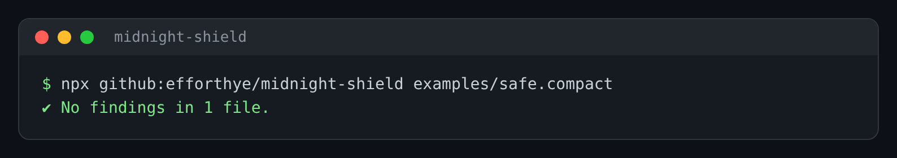
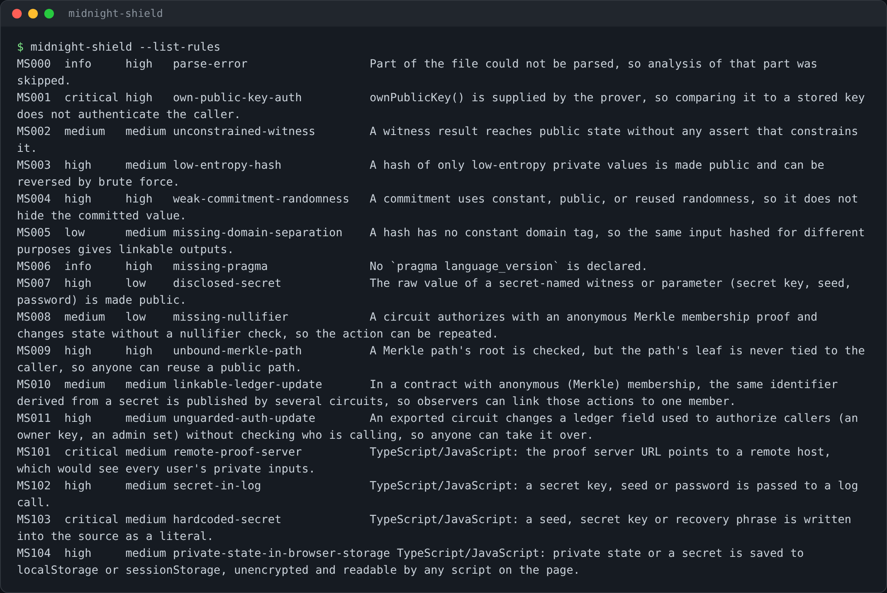
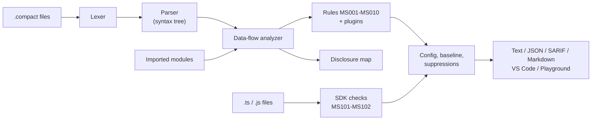

<div align="center">


# Midnight Shield

**Static analyzer for Midnight Compact contracts and the TypeScript code around them.**
Catch security and privacy bugs before you deploy: in your terminal, your editor, your browser, CI, and AI coding agents.

[](https://github.com/efforthye/midnight-shield/actions/workflows/ci.yml)
[](LICENSE)


-96%25-brightgreen)
[](https://www.npmjs.com/package/midnight-shield)

[Quick start](#quick-start) · [Web playground](#web-playground) · [Rules](#rules) · [Disclosure map](#disclosure-map) · [Editor](#vs-code) · [CI](#github-action) · [AI agents](#use-with-ai-coding-agents) · [Verification](#testing-and-verification) · [Pitch deck](#presentation)


**[▶ Try it in your browser](https://efforthye.github.io/midnight-shield/)** · no install, your code never leaves the page

<sub>Community project for the Midnight ecosystem. Not an official Midnight Foundation product.</sub>

</div>

---

## Why Midnight Shield?

The Compact compiler already stops you from disclosing witness data by accident. But a contract can **compile cleanly and still leak or be exploitable**:

| Bug | What goes wrong | Rule |
| --- | --- | --- |
| "Owner" check with `ownPublicKey()` | The prover supplies that value, so anyone can pass the check | [MS001](docs/rules/MS001.md) |
| Unchecked witness | The user can write any balance, score, or state to the ledger | [MS002](docs/rules/MS002.md) |
| Public hash of a vote, age, or PIN | Few possible inputs, so the hash can be brute-forced | [MS003](docs/rules/MS003.md) |
| Commitment with public or reused randomness | The commitment hides nothing, or links users together | [MS004](docs/rules/MS004.md) |
| `disclose(secretKey())` | The secret key is published for everyone to read | [MS007](docs/rules/MS007.md) |
| Merkle membership with no nullifier | One member can vote or claim again and again | [MS008](docs/rules/MS008.md) |
| Merkle root checked, leaf never checked | Anyone can reuse another member's public path | [MS009](docs/rules/MS009.md) |
| Same member tag in every circuit | Anonymous members' actions can be linked together | [MS010](docs/rules/MS010.md) |
| Remote proof server in the DApp | A third party sees every user's private inputs | [MS101](docs/rules/MS101.md) |
| Owner change with no caller check | Anyone can make themselves the owner or an admin | [MS011](docs/rules/MS011.md) |
| Wallet seed in a log | The seed ends up in CI logs and crash reports | [MS102](docs/rules/MS102.md) |
| Wallet seed in the source | Anyone who reads the repo or the web bundle can use it | [MS103](docs/rules/MS103.md) |
| Private state in `localStorage` | Any script on the page can read users' private data | [MS104](docs/rules/MS104.md) |
| `assert(isAdmin())` on a witness | The prover answers the witness, so anyone passes the check | [MS013](docs/rules/MS013.md) |
| Commitment randomness made public | Anyone can open the commitment by trying values | [MS014](docs/rules/MS014.md) |
| `transientHash` stored in the ledger | Stored values may stop matching after an upgrade | [MS012](docs/rules/MS012.md) |
| `Math.random()` for a salt or nonce | The value can be predicted | [MS105](docs/rules/MS105.md) |
| Seed sent to a server with `fetch` | The server, proxies and logs can read it | [MS106](docs/rules/MS106.md) |
| Nullifier checked but never stored | The same member can claim again and again | [MS018](docs/rules/MS018.md) |
| Nullifier built like the Merkle leaf | Anyone can see which member acted | [MS021](docs/rules/MS021.md) |
| Unguarded `sendShielded` or mint | Anyone can drain the contract or mint tokens | [MS019](docs/rules/MS019.md), [MS020](docs/rules/MS020.md) |
| Witness implemented as `new Uint8Array(32)` | The contract's "randomness" is all zeros | [MS113](docs/rules/MS113.md) |
| Seed in a `VITE_` variable | The bundler ships it to every visitor | [MS119](docs/rules/MS119.md) |

Midnight Shield is to Midnight what **Slither** is to Solidity and **aztec-lint** is to Noir: a static analyzer that catches issues before deploy, with rules built around Midnight's privacy model.

## Highlights

- 🔍 **Real parser and data-flow analysis.** Tracks every value back to witnesses, private inputs, public ledger state, or constants, across helper circuits and imported files.
- 🗺️ **Disclosure map.** One table of everything your contract makes public, and whether it is raw, hashed or committed. Unique to Midnight.
- 🎲 **Entropy-aware.** Knows a `Boolean` vote has 1 bit of secret entropy and a `Bytes<32>` key has 256, so it flags brute-forceable hashes without crying wolf.
- 🎯 **Honest about certainty.** Every finding has a severity *and* a confidence. Rules that rely on names or guess intent say so.
- 🧪 **Measured on other people's code.** A field test on 36 third-party Midnight projects (90% precision on the first scan, every finding checked by hand, [details](verify/field-test.md)), plus a labeled benchmark with precision and recall per rule ([results](bench/RESULTS.md)). 1,052 real files of the official examples and OpenZeppelin Contracts for Compact parse with zero errors, and each medium-or-worse finding on them is checked by hand. Examples are compiled with the real Compact compiler.
- 🔗 **Contract and DApp read together.** When a scan covers both, Midnight Shield matches the witnesses a contract declares with their TypeScript implementations, so it can tell that `bidSalt` (a name no rule would guess) is a commitment's randomness, and that its implementation returns zeros (MS121). It also follows state across circuits: a field anyone can set in one circuit and another circuit trusts (MS034).
- 🔁 **Privacy diff on every pull request.** The GitHub Action comments what a change newly makes public and which findings it adds or fixes, before it is merged.
- 🩹 **Suggested fixes.** Each finding comes with the flagged line rewritten, as a diff you can copy.
- 🧰 **Everywhere you work.** CLI, web playground, VS Code, GitHub Action with SARIF, Markdown reports, Claude Code skill, plugin API.
- 🏗️ **Easy to adopt.** Baselines accept existing findings so CI only fails on new ones. Zero runtime dependencies.

## Quick start

Requires Node.js 20 or later.

```bash
# run once, no install
npx midnight-shield contracts/

# or add it to your project
npm install --save-dev midnight-shield
npx midnight-shield contracts/

# or install globally
npm install -g midnight-shield
midnight-shield contracts/
```

Not ready to install anything? Scan your GitHub repository or paste a contract in the **[web playground](#web-playground)**.

The repository has examples: [`examples/vulnerable.compact`](examples/vulnerable.compact) triggers every Compact rule, [`examples/dapp/vulnerable.ts`](examples/dapp/vulnerable.ts) every TypeScript rule, and the `safe` versions show the fixes (0 findings).

## Web playground

**[efforthye.github.io/midnight-shield](https://efforthye.github.io/midnight-shield/)**

The full analyzer, compiled to run in the browser. Check your own project in three ways:

| | How | What happens |
| --- | --- | --- |
| **Scan a GitHub repo** | Enter `github.com/owner/repo` (or a `…/tree/<branch>/<folder>` link) and press **Scan repo** | Your browser downloads the repository's `.compact` and DApp TypeScript files straight from GitHub and analyzes them together, with imports resolved |
| **Open files or a folder** | **Open files**, **Open folder**, or drag and drop | Files are read locally. Nothing is uploaded |
| **Paste code** | Type or paste into the editor | Findings update as you type |

There is no server: the page is static, and your code stays in your browser. Public repositories only.


| Findings with fixes | Disclosure map |
| --- | --- |
|  |  |

- **Suggested fixes** under each finding, as a diff with a **Copy fix** button
- **Whole-project results** grouped by file. Click a finding to open that file at the line
- **Disclosure map** tab: every value that becomes public, and whether it is raw, hashed or committed
- **Share link**: a repository scan is shared as `…/#repo=owner/repo`, so anyone can rerun it; pasted code is stored in the link itself
- **Download report** as Markdown for an audit note or a PR comment
- Examples, severity filter, light and dark themes, and a mobile layout

Show your project's status in its README with a badge that updates on every push (set up in the [GitHub Action](#status-badge)). It looks like  or  and opens the scan in the playground when clicked.

To run it locally: `npm run playground` builds a single file at `playground/dist/index.html` that you can open directly.

## Usage guide

### 1. Scan

```bash
npx midnight-shield contracts/          # .compact files and the DApp's .ts/.js files
npx midnight-shield contracts/ --no-sdk # only .compact files
```

Midnight Shield skips `node_modules`, `dist`, `build`, compiler output and, for TypeScript checks, test files. It follows `import "..."` into other Compact files.

### 2. Read a finding

Each finding shows its **severity**, **rule**, **location** (clickable in most terminals), **confidence** when it is not high, the **message** with the fix, a **code frame**, and a link to the rule page.

```bash
npx midnight-shield explain MS009   # read a rule's documentation in the terminal
```

### 3. Fix and scan again

Each finding shows a **suggested fix**: the flagged line rewritten, as a diff. Names only you can choose (a domain tag, a witness) appear as placeholders such as `myapp`. Every rule page also shows a vulnerable and a fixed example.

```text
  Suggested fix
    - committed = persistentCommit<Uint<64>>(amount, salt);
    + committed = persistentCommit<Uint<64>>(amount, randomness());
```

Safe fixes can be applied automatically:

```bash
npx midnight-shield contracts/ --fix-dry-run   # see what would change
npx midnight-shield contracts/ --fix           # apply
```

Only fixes that cannot change what a contract does are automatic (today: adding a missing `pragma`). Fixes that change hashes or commitments would change on-chain values, so they are left to you or to the [AI skill](#use-with-ai-coding-agents).



### 4. Adopt it in an existing project

Accept today's findings and fail CI only on new ones:

```bash
npx midnight-shield contracts/ --write-baseline .midnight-shield-baseline.json
npx midnight-shield contracts/ --baseline .midnight-shield-baseline.json
```

Baseline entries are matched by a fingerprint of the rule and the code line, so moving code around does not break them. `--show-suppressed` lists everything that is hidden by a baseline or an inline comment, for audits.

Or start from a preset:

| Preset | Shows | Fails the build on | Suppressions |
| --- | --- | --- | --- |
| `recommended` | low severity and up, medium confidence and up | high, critical | as written |
| `strict` | everything | medium and up | must give a reason |

```bash
npx midnight-shield contracts/ --preset recommended
```

or `"preset": "recommended"` in the config file. Settings next to it in the config, and command-line options, override the preset.

### 5. Configure

```bash
npx midnight-shield --init   # creates midnight-shield.config.json
```

```json
{
  "disable": [],
  "failOn": "high",
  "minSeverity": "info",
  "minConfidence": "low",
  "ignore": ["**/test/**"],
  "baseline": ".midnight-shield-baseline.json",
  "plugins": ["./tools/our-rules.mjs"],
  "sdk": true,
  "preset": "recommended",
  "requireSuppressionReason": false
}
```

To silence one finding in code, say why next to it:

```compact
// shield-disable-next-line MS005 -- the tag is supplied by every caller
const h = persistentHash<Vector<2, Bytes<32>>>([tag, sk]);
```

`shield-disable-line` and `shield-disable-file` work the same way. Leave out the rule ID to suppress every rule.

The reason after `--` is kept with the finding: `--show-suppressed` prints it, JSON has it as `suppressionReason`, and SARIF records it as the suppression's `justification`, so GitHub code scanning shows why a finding was dismissed. With `--require-suppression-reason` (or `"requireSuppressionReason": true`, or the `strict` preset), a comment without a reason no longer hides the finding.

### 6. Report

```bash
npx midnight-shield contracts/ --format markdown -o report.md   # audit or PR report
npx midnight-shield contracts/ --format sarif -o results.sarif  # GitHub code scanning
npx midnight-shield contracts/ --format json                    # scripts and AI agents
```

## Rules



**Compact contracts**

| ID | Name | Severity | Confidence | Finds |
| --- | --- | --- | --- | --- |
| [MS001](docs/rules/MS001.md) | `own-public-key-auth` | 🟣 Critical | high | `ownPublicKey()` compared to a key to authorize the caller, including through helper circuits |
| [MS002](docs/rules/MS002.md) | `unconstrained-witness` | 🟡 Medium | medium | A witness value reaches public state with no `assert` that checks it |
| [MS003](docs/rules/MS003.md) | `low-entropy-hash` | 🔴 High | medium | A hash of only low-entropy private values (vote, age, PIN) made public |
| [MS004](docs/rules/MS004.md) | `weak-commitment-randomness` | 🔴 High | high | A commitment with constant, public, short, or reused randomness |
| [MS005](docs/rules/MS005.md) | `missing-domain-separation` | 🔵 Low | medium | A hash of private data with no constant domain tag |
| [MS006](docs/rules/MS006.md) | `missing-pragma` | ⚪ Info | high | No `pragma language_version` (auto-fixable) |
| [MS007](docs/rules/MS007.md) | `disclosed-secret` | 🔴 High | low | The raw value of a secret key, seed, or password is made public |
| [MS008](docs/rules/MS008.md) | `missing-nullifier` | 🟡 Medium | low | Merkle-authorized state change with no nullifier, so it can be repeated |
| [MS009](docs/rules/MS009.md) | `unbound-merkle-path` | 🔴 High | high | Merkle root checked, but the path's leaf is never tied to the caller |
| [MS010](docs/rules/MS010.md) | `linkable-ledger-update` | 🟡 Medium | medium | In an anonymous-membership contract, the same secret-derived tag is published by several circuits |
| [MS011](docs/rules/MS011.md) | `unguarded-auth-update` | 🔴 High | medium | An exported circuit changes an owner key or admin set without checking the caller |
| [MS012](docs/rules/MS012.md) | `transient-hash-in-state` | 🟡 Medium | high | A `transientHash` / `transientCommit` result stored in the ledger |
| [MS013](docs/rules/MS013.md) | `witness-controlled-assert` | 🔴 High | high | An `assert` that only checks a `Boolean` the prover supplies through a witness |
| [MS014](docs/rules/MS014.md) | `commitment-randomness-disclosed` | 🔴 High | medium | The randomness of a commitment made public outside a commit-reveal opening |
| [MS015](docs/rules/MS015.md) | `unused-witness` | ⚪ Info | high | A witness is declared but never called; often a sign of a missing check |
| [MS016](docs/rules/MS016.md) | `unused-circuit` | ⚪ Info | high | A circuit that is not exported is never called, so it is dead code |
| [MS017](docs/rules/MS017.md) | `tautological-assert` | 🟡 Medium | high | An assert can never fail (assert(true), x == x, an unsigned value >= 0), so it checks nothing |
| [MS018](docs/rules/MS018.md) | `nullifier-not-checked` | 🔴 High | medium | A value is added to a nullifier set without first checking that it is not already there, so it can be used again |
| [MS019](docs/rules/MS019.md) | `unguarded-token-send` | 🔴 High | medium | An exported circuit sends tokens and checks nothing, so anyone can move the contract's funds |
| [MS020](docs/rules/MS020.md) | `unguarded-mint` | 🔴 High | medium | An exported circuit mints tokens and checks nothing, so anyone can mint any amount |
| [MS021](docs/rules/MS021.md) | `nullifier-matches-leaf` | 🔴 High | medium | A nullifier is built from the same tag and inputs as a Merkle leaf, so it reveals which member acted |
| [MS022](docs/rules/MS022.md) | `shadowed-ledger-field` | 🔵 Low | high | A parameter or local constant has the same name as a ledger field and hides it |
| [MS023](docs/rules/MS023.md) | `secret-key-as-randomness` | 🔴 High | medium | A long-term secret key is used as commitment randomness, so opening the commitment reveals the key |
| [MS024](docs/rules/MS024.md) | `constant-condition` | 🟡 Medium | high | An if on a constant, or assert(false): one branch is dead or the circuit always fails |
| [MS025](docs/rules/MS025.md) | `write-after-write` | 🟡 Medium | high | A ledger field is written twice in a row with no read in between, so the first write has no effect |
| [MS026](docs/rules/MS026.md) | `shadowed-builtin` | 🔵 Low | high | A circuit, witness, parameter or local hides a standard-library name such as disclose or persistentHash |
| [MS027](docs/rules/MS027.md) | `ignored-check-result` | 🔴 High | high | A Boolean check (a member test, a helper returning Boolean) is called but its result is thrown away |
| [MS028](docs/rules/MS028.md) | `locked-tokens` | 🟡 Medium | medium | The contract receives tokens but no circuit sends any out, so deposits are locked |
| [MS029](docs/rules/MS029.md) | `no-effect-statement` | 🔵 Low | high | A statement computes a value and does nothing with it |
| [MS030](docs/rules/MS030.md) | `bidi-control-character` | 🔴 High | high | An invisible text-direction character can make code read differently from how it runs (Trojan Source) |
| [MS031](docs/rules/MS031.md) | `field-arithmetic-overflow` | 🔴 High | medium | Arithmetic on a Field ledger value wraps around silently instead of failing |
| [MS032](docs/rules/MS032.md) | `unused-local` | ⚪ Info | high | A local constant is computed but never used |
| [MS033](docs/rules/MS033.md) | `unsupported-language-version` | 🔵 Low | high | The pragma asks for a Compact version outside the tested range, so new syntax may be misread |
| [MS034](docs/rules/MS034.md) | `untrusted-state-dependency` | 🔴 High | medium | A ledger field any caller can set is trusted by another circuit in a check or a token transfer |
| [MS035](docs/rules/MS035.md) | `inconsistent-guard` | 🔴 High | medium | One circuit checks the caller before changing a field, another overwrites the same field with no check |
| [MS036](docs/rules/MS036.md) | `claimed-identity` | 🟣 Critical | medium | An "owner check" compares a stored id with a parameter; the ledger is public, so anyone can pass the stored id |
| [MS037](docs/rules/MS037.md) | `self-satisfiable-check` | 🔴 High | medium | An assert compares only values the prover chooses (witness results, parameters), so it can always be made to pass |

**DApp code (TypeScript / JavaScript)**

Secrets are recognized by name (`seed`, `secretKey`, `mnemonic`, …) and by where the value comes from: a variable assigned from `privateState.secretKey`, from a seed or mnemonic generator, or re-encoded from another secret counts as a secret whatever it is called.

| ID | Name | Severity | Confidence | Finds |
| --- | --- | --- | --- | --- |
| [MS101](docs/rules/MS101.md) | `remote-proof-server` | 🟣 Critical | medium | The proof server URL points to a remote host |
| [MS102](docs/rules/MS102.md) | `secret-in-log` | 🔴 High | medium | A seed, secret key or password passed to a log call |
| [MS103](docs/rules/MS103.md) | `hardcoded-secret` | 🟣 Critical | medium | A seed, secret key or recovery phrase written into the source |
| [MS104](docs/rules/MS104.md) | `private-state-in-browser-storage` | 🔴 High | medium | Private state or a secret saved to `localStorage` / `sessionStorage` |
| [MS105](docs/rules/MS105.md) | `insecure-randomness` | 🔴 High | medium | A secret, seed, nonce or salt made with `Math.random()` |
| [MS106](docs/rules/MS106.md) | `secret-sent-over-network` | 🔴 High | medium | A seed or secret key sent with `fetch`, `axios` or another HTTP client |
| [MS107](docs/rules/MS107.md) | `tls-verification-disabled` | 🔴 High | high | TLS certificate checks are turned off |
| [MS108](docs/rules/MS108.md) | `dynamic-code-execution` | 🔴 High | medium | Eval, new Function or a string passed to setTimeout runs a string as code |
| [MS109](docs/rules/MS109.md) | `insecure-transport` | 🟡 Medium | medium | A remote indexer or node is reached over unencrypted http:// or ws:// |
| [MS110](docs/rules/MS110.md) | `secret-in-error` | 🟡 Medium | medium | A secret key, seed or password is put into an error message |
| [MS111](docs/rules/MS111.md) | `secret-written-to-file` | 🟡 Medium | medium | A secret key, seed or password is written to a file unencrypted |
| [MS112](docs/rules/MS112.md) | `postmessage-wildcard` | 🟡 Medium | high | PostMessage sends data to any origin ("*") |
| [MS113](docs/rules/MS113.md) | `weak-witness-randomness` | 🟣 Critical | medium | A witness implementation returns zero bytes or a clock value where the contract expects secret randomness |
| [MS114](docs/rules/MS114.md) | `secret-in-url` | 🔴 High | medium | A secret is put into the page URL, query string or browser history |
| [MS115](docs/rules/MS115.md) | `hardcoded-password` | 🔴 High | medium | A password or passphrase (for example for the private state store) is written into the source |
| [MS116](docs/rules/MS116.md) | `secret-rendered-in-ui` | 🟡 Medium | medium | A secret is rendered on screen in JSX |
| [MS117](docs/rules/MS117.md) | `secret-sent-to-analytics` | 🔴 High | medium | A secret is passed to an analytics or error-tracking call |
| [MS118](docs/rules/MS118.md) | `unsafe-html` | 🟡 Medium | medium | HTML from a variable is written into the page (innerHTML, dangerouslySetInnerHTML, document.write) |
| [MS119](docs/rules/MS119.md) | `secret-in-public-env` | 🟣 Critical | high | A secret is read from a VITE_/NEXT_PUBLIC_/REACT_APP_ variable, which the bundler ships to every visitor |
| [MS120](docs/rules/MS120.md) | `secret-from-public-data` | 🔴 High | medium | A secret computed only from public values such as an address or a public key, so anyone can recompute it |
| [MS121](docs/rules/MS121.md) | `weak-witness-implementation` | 🟣 Critical | high | Contract and DApp together: a witness the contract uses as randomness or a secret key is implemented with zeros, a clock, `Math.random()` or a constant |

Need a rule for your own conventions? [Write a plugin](docs/custom-rules.md).

## Disclosure map

On Midnight, everything that becomes public is explicit. The disclosure map lists all of it in one place, so a reviewer can check the privacy of a contract in minutes:

```bash
npx midnight-shield contracts/ --print disclosures
```


`RAW` means private data is published as is. That is sometimes intended (a public balance), but every `RAW` row deserves a second look. The map is also available as JSON and Markdown (`--format json|markdown`), in the playground, and in VS Code.

## Access map

The access map answers the first question of every audit: who can call each circuit, and what can they change?

```bash
npx midnight-shield contracts/ --print access
```

```text
contracts/staking.compact
  circuit               who can call    changes                   tokens          checks
  stake                 BYPASSABLE      stakedBalances, totalStak -               witness result l.170 (MS013)  ⚠ MS013
  updateRewardRate      BYPASSABLE      rewardRateValue, nonce    -               claimed id l.267 (MS036)  ⚠ MS036
  setFee                restricted      fee                       -               secret l.21
  resetFee              anyone          fee                       -               -  ⚠ MS035
```

For every exported circuit it lists the ledger fields it changes, the tokens it sends, mints or receives, and every check on the way, including checks in helper circuits and in imported modules (the module is read to see what `assertOnlyOwner()` really checks). Each check is classified:

| Check | Means |
| --- | --- |
| `secret`, `allow-list`, `signature`, `Merkle proof` | Ties the call to the caller |
| `ownPublicKey()`, `witness result`, `claimed id`, unbound `Merkle proof` | Looks like a caller check, but the prover controls it (MS001, MS013, MS036, MS009) |
| `one-time`, `state`, `inputs` | Limits how often, when or how much, not who |

**BYPASSABLE** means every caller check on the circuit is one anyone can pass. Two rules are built on the map: MS035 (a field one circuit protects and another changes freely) and MS036 (an owner check that compares with a parameter). JSON and Markdown are available with `--format json|markdown`.

## Witness constraint report

A proof is only as strong as the checks that tie the prover's values to something the prover does not choose. The witness report lists every prover-chosen value (witness results and circuit parameters), where it ends up, and what constrains it:

```bash
npx midnight-shield contracts/ --print witnesses
```

```text
contracts/hiring.compact
  circuit             prover-chosen value     status     reaches                           constrained by
  proveCredential     localCredentialId()     anchored   -                                 ledger l.169
  proveRegistered     localSecretKey()        secret     return value (hashed)             -
  proveMinRating      localRating()           CIRCULAR   -                                 prover values only l.129
                      threshold               CIRCULAR   return value                      prover values only l.129
```

| Status | Means |
| --- | --- |
| `anchored` | Compared with ledger state, opened through a hash or signature, checked for membership, or received as a coin |
| `bounded` | Limited by a constant only |
| `secret` | Only used inside hashes and commitments, as a secret should be |
| `input` | A parameter used as given |
| `CIRCULAR` | Only compared with other prover-chosen values, so the check can always be satisfied (MS037) |
| `FREE` | A witness value that reaches state or a transfer with no check at all (MS002) |

Values are followed through local constants, helper circuits (parameters bound to the caller's arguments, return values followed back), and comparisons inside helpers. This is the Compact counterpart of the under-constrained analyses of Circomspect and Picus for Circom.

## Upgrade check

A deployed contract keeps its ledger state; its maintenance authority can only swap circuit verifier keys. The compiled contract reads ledger fields by position, so new circuits from reordered or retyped declarations read the old state in the wrong place. Compare two versions before you upgrade:

```bash
npx midnight-shield upgrade release-1.0/contracts contracts
```

```text
contract.compact
  CRITICAL  field-moved  paused  (new line 5)
  New ledger field 'paused' is inserted at position 1, where the deployed state holds 'fee'. Every field after it
  moves one position (fee, phase, total), so each of them reads its neighbour's old value. Add new fields at the end.

  CRITICAL  type-changed  Phase  (new line 3)
  Enum 'Phase' changed from [open, closed] to [pending, open, closed]. The ledger stores enum values by index, ...

  HIGH      access-weakened  setFee  (new line 12)
  'setFee' checks the caller in the old version but is open to anyone in the new one, and it changes fee.
```

It reports removed, inserted, reordered and retyped ledger fields, changed enums and structs stored in the ledger, changed circuit and witness signatures, removed circuits (still callable until their verifier key is removed), and circuits whose caller check got weaker, using the access map. The full list and its reasons are in [docs/upgrade.md](docs/upgrade.md). This is the Compact counterpart of `slither-check-upgradeability`.

## How it works



For every circuit, the analyzer evaluates each expression to a summary of where its value came from:

| Source | Example | Treated as |
| --- | --- | --- |
| Witness | `secretKey()` | Private, prover-controlled |
| Circuit parameter | `amount: Uint<64>` | Private |
| Ledger state | `owner`, `balances.lookup(k)` | Public |
| Constant | `pad(32, "app:")`, `default<Bytes<32>>`, enum members | Public, zero entropy |
| `disclose(x)` | | Public from this point on |

Secret entropy is estimated from types (`Boolean` = 1 bit, `Uint<16>` = 16, `Bytes<32>` = 256). Calls to circuits in the same file or in imported modules are evaluated with the caller's arguments, so a check hidden in a helper is still found.

The rules follow the [Midnight security best practices](https://docs.midnight.network/guides/security-best-practices) and the [explicit disclosure](https://docs.midnight.network/compact/explicit_disclosure) rules.

## VS Code

The extension in [`vscode/`](vscode) shows findings as you type, with links to each rule, a **Scan workspace** command and a **Show disclosure map** command. It reads `midnight-shield.config.json` and inline suppressions. See [`vscode/README.md`](vscode/README.md) to build and install it.

## GitHub Action

```yaml
# .github/workflows/midnight-shield.yml
name: Midnight Shield
on:
  push:
    branches: [main]
  pull_request:

jobs:
  scan:
    runs-on: ubuntu-latest
    permissions:
      contents: write        # publish the status badge (or read without badge: true)
      pull-requests: write   # comment the privacy diff
      security-events: write # show results in the Security tab
    steps:
      - uses: actions/checkout@v4
      - uses: efforthye/midnight-shield@main
        with:
          path: contracts
          fail-on: high
          badge: true
```

`@main` picks up changes as soon as they are merged. To decide when updates reach your CI, pin a release tag or a commit SHA once a release includes the inputs you use.

What it does:

- **Every run:** scans, fails the job at `fail-on`, and puts findings in **Security → Code scanning** and as annotations on pull requests.
- **Pull requests:** comments a **privacy diff** and keeps that one comment up to date as you push.
- **Pushes to the default branch** (with `badge: true`): updates the status badge.

### Privacy diff

On a pull request, Midnight Shield scans both the base and the change, and comments what the change does to privacy:


Lines that only moved are not reported. A protection that gets weaker (commitment → hash → raw) is marked ⚠️. The same diff works locally:

```bash
npx midnight-shield snapshot contracts -o base.json   # on main
npx midnight-shield snapshot contracts -o head.json   # on your branch
npx midnight-shield diff base.json head.json          # --format markdown|json, --fail-on high
```

### Status badge

With `badge: true`, each push to the default branch writes the result to a `midnight-shield-badge` branch. Add the badge to your README (replace `OWNER/REPO`):

```markdown
[](https://efforthye.github.io/midnight-shield/#repo=OWNER/REPO)
```

It shows  when the scan is clean. Otherwise it shows the number of the most severe findings: red for critical or high, such as , orange for medium, such as , and yellow for low, such as . "Verified" means the code passes every Midnight Shield check, not that it was audited. `--badge badge.json` writes the same file from the CLI.

| Input | Default | Description |
| --- | --- | --- |
| `path` | `.` | Files or folders to scan |
| `fail-on` | `high` | Fail the job at or above this severity (`none` to never fail) |
| `upload-sarif` | `true` | Upload results to GitHub code scanning |
| `pr-comment` | `true` | Comment the privacy diff on pull requests |
| `badge` | `false` | Publish the status badge on pushes to the default branch |

## Use with AI coding agents

### Claude Code skill

[`skills/midnight-shield`](skills/midnight-shield/SKILL.md) teaches Claude Code to scan, fix findings in order of severity, check the disclosure map, and re-scan until the contract is clean:

```bash
mkdir -p .claude/skills
cp -r node_modules/midnight-shield/skills/midnight-shield .claude/skills/
```

### JSON and the library API

```bash
npx midnight-shield contracts/ --format json --fail-on none
```

```ts
import { lintSource, mapDisclosures } from "midnight-shield";

const findings = lintSource(source, "counter.compact");
const publicData = mapDisclosures(source, "counter.compact");
```

## CLI reference

```text
midnight-shield [paths...] [options]
midnight-shield explain <RULE>
midnight-shield snapshot [paths...] -o snapshot.json
midnight-shield diff <base.json> <head.json>
midnight-shield upgrade <old> <new>
midnight-shield --init

Output:     -f, --format text|json|sarif|markdown   -o, --output <file>
            --print disclosures|access|witnesses   --badge <file>   --no-code-frame   --no-suggestions   --no-color
Filtering:  --fail-on <severity>  --min-severity <severity>  --min-confidence <confidence>
            --disable <IDs>  --ignore <glob>  --no-sdk  --show-suppressed
Adoption:   --baseline <file>  --write-baseline <file>  --fix  --fix-dry-run
            -c, --config <file>  --plugin <module>
Other:      --list-rules  -v, --version  -h, --help
```

Exit codes: `0` no blocking findings, `1` findings at or above `--fail-on`, `2` usage or config error.

## Accuracy

Accuracy is measured two ways.

**Field test on third-party code.** 36 public Midnight projects found through GitHub search, scanned with default settings, every medium-or-worse finding checked against the source. On the first scan, before any change for this test, **121 of 134 findings were real issues (90% precision)**. The 13 false positives were fixed; each one and its fix is listed in [verify/field-test.md](verify/field-test.md), along with why the official examples and OpenZeppelin code show so few findings (some patterns, such as Boolean witnesses, never occur there).

**Labeled benchmark.** 188 labeled files: 128 expected findings reported, 0 missed, 0 false positives. For each rule: the plain vulnerable pattern, variants written to slip past it (aliases, helper circuits, structs, negations, wrappers, other names), and safe code that looks similar. The ten core rules get the most cases:

| Rule | Expected findings | Found | Missed | False positives | Precision | Recall |
| --- | ---: | ---: | ---: | ---: | ---: | ---: |
| MS001 | 5 | 5 | 0 | 0 | 100% | 100% |
| MS002 | 4 | 4 | 0 | 0 | 100% | 100% |
| MS003 | 5 | 5 | 0 | 0 | 100% | 100% |
| MS004 | 4 | 4 | 0 | 0 | 100% | 100% |
| MS007 | 7 | 7 | 0 | 0 | 100% | 100% |
| MS008 | 5 | 5 | 0 | 0 | 100% | 100% |
| MS009 | 7 | 7 | 0 | 0 | 100% | 100% |
| MS011 | 5 | 5 | 0 | 0 | 100% | 100% |
| MS013 | 10 | 10 | 0 | 0 | 100% | 100% |
| MS014 | 3 | 3 | 0 | 0 | 100% | 100% |

All rules together:

| Rule | Found | Missed | False positives | Precision | Recall |
| --- | ---: | ---: | ---: | ---: | ---: |
| **All** | **128** | **0** | **0** | **100%** | **100%** |

CI also compiles every Compact case with the real Compact compiler and lists any that do not compile in the job summary. Each rule's page has a **Known limits** section.

**Real-world reproductions.** Minimal versions of bugs found in public projects are part of the benchmark ([bench/known](bench/known)):

| Case | Rules | Result | Source |
| --- | --- | --- | --- |
| `dividend-claim-unbound-path.compact` | MS009 | found | report pending |
| `meshjs-lending-borrow.compact` | MS008, MS009, MS013 | found | [link](https://github.com/MeshJS/midnight-contracts-wizard/issues/1) |
| `meshjs-oracle-submit.compact` | MS008, MS009, MS013 | found | [link](https://github.com/MeshJS/midnight-contracts-wizard/issues/1) |
| `official-leaderboard-storage.ts` | MS104 | found | [link](https://github.com/midnightntwrk/midnight-examples) |
| `pause-flag-unguarded.compact` | MS034 | found | report pending |
| `role-key-from-public-key.ts` | MS120 | found | report pending |
| `secret-key-as-map-key.compact` | MS007 | found | report pending |
| `staking-claimed-owner-id.compact` | MS036 | found | report pending |
| `claimed-rating-threshold.compact` | MS037 | found | report pending |

**Found in a public project.** Scanning [MeshJS/midnight-contracts-wizard](https://github.com/MeshJS/midnight-contracts-wizard) (contract templates that developers copy, commit `a1f868d`) found access checks that a caller can bypass. Each was checked by hand against the source. [▶ See the scan in the playground](https://efforthye.github.io/midnight-shield/#repo=MeshJS/midnight-contracts-wizard/tree/a1f868d/packages/contract/src) (also under **Examples… → Real projects**). Reported to the maintainers in [MeshJS/midnight-contracts-wizard#1](https://github.com/MeshJS/midnight-contracts-wizard/issues/1).

| Contract | Rule | What a caller can do |
| --- | --- | --- |
| `lending-borrowing` | MS013, MS009 | Borrow with no collateral: the health-factor check is a witness that returns `true` on request, and the collateral Merkle path is not tied to the caller |
| `lending-borrowing` | MS013, MS009 | Liquidate any position, and withdraw collateral, through the same pattern |
| `oracle` | MS009, MS013 | Write prices as any operator (another operator's public path passes), and pass the signature check, which is a witness |
| `staking` | MS013 | Skip the balance check and the lock-up period, both witnesses |
| `tokenization` | MS013, MS009 | Pass the project-expiry check and the investor membership check |

The same scan also showed false positives, which led to fixes: a secret passed through `disclose()` straight into a hash or commitment is no longer reported (MS007, MS004, MS014), because only the result becomes public.

**Official examples.** On 1,052 files of the official Midnight examples and OpenZeppelin Contracts for Compact, the medium-or-worse findings are all checked by hand ([verify/reviewed.json](verify/reviewed.json)):

| Rule | Where | What it is |
| --- | --- | --- |
| MS104 | `leaderboard` example | The player's secret key is kept in `localStorage`, where any script on the page can read it |
| MS019, MS020 | `token-transfers`, `private-tip-jar` examples | Anyone can mint or send the demo tokens; deliberate in demos, and what the rules are for in real contracts |
| MS019 | OpenZeppelin `MockUnshieldedTreasury` | A test mock that sends without checks on purpose |

Building the newer rules also turned up a parser bug (`default<T> as U`) that the corpus run now covers.

## Supported Compact versions

Midnight Shield has its own parser, tested with **Compact language 0.16–0.28**: the official examples, OpenZeppelin Contracts for Compact and the benchmark. It does not need the compiler installed.

- A file whose `pragma language_version` only allows versions outside that range gets **MS033**, and the CLI prints a warning.
- A part of a file the parser cannot read is reported as **MS000** with its location, skipped, and also counted in that warning, so a clean result is never silently partial.
- The CI corpus run fails on any parse error in 1,052 real files, so grammar drift shows up there first.

## Coverage compared with other analyzers

Rules were checked against the detector lists of [Slither](https://github.com/crytic/slither/wiki/Detector-Documentation) (Solidity) and [Circomspect](https://github.com/trailofbits/circomspect) (Circom). Where a detector's bug class exists in Compact, there is a rule for it:

| Bug class | Slither / Circomspect | Midnight Shield |
| --- | --- | --- |
| Unprotected value transfer | `arbitrary-send-eth` | MS019 |
| Unprotected privileged change | `protected-vars`, `suicidal` | MS011, MS020, MS034, MS035 |
| Who can call what | `vars-and-auth` printer | `--print access` |
| Upgrade safety | `slither-check-upgradeability` | `midnight-shield upgrade` |
| Caller identity from an untrusted source | `tx-origin` | MS001, MS013, MS036 |
| Weak randomness | `weak-prng` | MS004, MS105, MS113 |
| Tautologies | `tautology`, `tautological-compare` | MS017 |
| Constant conditions | `boolean-cst`, constant branch | MS024 |
| Ignored return values | `unused-return`, `unchecked-transfer` | MS027 |
| Locked funds | `locked-ether` | MS028 |
| Overwritten state | `write-after-write` | MS025 |
| Shadowing | `shadowing-state`, `shadowing-builtin`, `shadowing-local` | MS022, MS026 |
| Dead code and unused values | `dead-code`, `unused-state`, unused variables | MS015, MS016, MS032 |
| Statements with no effect | `redundant-statements` | MS029 |
| Hidden text-direction characters | `rtlo` | MS030 |
| Arithmetic that wraps | field arithmetic (Circomspect) | MS031 |
| Unconstrained private inputs | under-constrained signals (Circomspect, Picus) | MS002, MS009, MS037, `--print witnesses` |
| Compiler version | `solc-version`, `pragma` | MS006 |

Detectors for things Compact does not have (reentrancy, `delegatecall`, gas, inline assembly, inheritance, ERC interfaces, events) have no counterpart. On top of the shared bug classes, about half of the rules cover Midnight's privacy model, which the other tools do not deal with: disclosure of secrets (MS003, MS007, MS014, MS021, MS023), nullifiers (MS008, MS018), Merkle membership (MS009, MS010), transient hashes (MS012), and the DApp side where witnesses and private state live (MS101–MS120).

## Where it fits

Midnight Shield works alongside the tools you already use. Each does a different job:

| Tool | What it does | Use it for |
| --- | --- | --- |
| Compact compiler | Checks types and makes every disclosure of private data explicit | Writing correct contracts. Always required |
| **Midnight Shield** | Data-flow analysis built around Midnight's privacy model: the disclosure map, entropy-aware hash checks, suggested fixes and a privacy diff on pull requests | Catching privacy and security bugs before deploy, in your editor, in CI and with AI agents |

On other chains, the same role is played by [Slither](https://github.com/crytic/slither) for Solidity and aztec-lint for Noir.

## Testing and verification

| Check | What it proves | Command |
| --- | --- | --- |
| **Unit and integration tests** (421 tests) | Lexer, parser, every rule (flagged and not-flagged cases), suggested fixes, privacy diff, badge, reporters, CLI, baselines, plugins | `npm test`, `npm run coverage` |
| **Benchmark** | 188 labeled files: the plain vulnerable pattern for each rule, variants written to evade it, look-alike safe code, and minimal reproductions of real bugs. Precision and recall per rule in [bench/RESULTS.md](bench/RESULTS.md); CI also compiles every Compact case with the real compiler | `npm run bench` |
| **Fuzz tests** | Random token edits, truncations, random bytes, deep nesting and recursive circuits never crash the analyzer | part of `npm test` |
| **Corpus verification** | 1,052 real files (Compact and TypeScript) at pinned commits: zero parse errors, results match a reviewed baseline, and every medium-or-worse finding is checked by hand and listed with the reason in [`verify/reviewed.json`](verify/reviewed.json) | `npm run verify` |
| **Real compiler** | The example contracts compile with the official `compact` toolchain | CI job `compile-examples` |
| **Package** | The npm tarball installs and the CLI runs | CI job `package` |


## Roadmap

- [x] **v0.1** Parser, data-flow analysis, CLI, GitHub Action, SARIF
- [x] **v0.2** Imported modules, code frames, config file, Claude Code skill
- [x] **v0.3** Merkle and secret rules, corpus verification, real-compiler CI
- [x] **v0.4** Disclosure map, confidence, baselines, Markdown, plugins, autofix, TypeScript checks, playground, VS Code extension, npm package
- [x] **v0.5** Repository and folder scanning in the playground, project logo, GitHub Packages
- [x] **v0.6** Privacy diff on pull requests, status badge, suggested fixes, accuracy benchmark, field test, presets, ignore comments with a reason, witness implementations checked against the contract (MS121)
- [x] **Next** Access map (`--print access`) with imported modules resolved, inconsistent guards (MS035), claimed identities (MS036), witness constraint report (`--print witnesses`) and self-satisfiable checks (MS037), upgrade check (`midnight-shield upgrade`)
- [ ] MCP server and language server
- [ ] VS Code Marketplace release
- [ ] Data-flow facts for plugins
- [ ] More rules from community feedback

Ideas and false-positive reports are welcome in [Issues](https://github.com/efforthye/midnight-shield/issues).

## Development

```bash
npm install
npm test            # build + tests
npm run coverage    # tests with coverage
npm run verify      # scan real Midnight code and compare with the baseline
npm run playground  # build the web playground into playground/dist
npm run demo        # scan examples/
```

See [CONTRIBUTING.md](CONTRIBUTING.md), [SECURITY.md](SECURITY.md) and [CHANGELOG.md](CHANGELOG.md).

## Presentation

The pitch deck from KR NightForce Cohort 2: the problem, the solution, how it compares and how it was verified.

- [Slides (PDF)](presentation/midnight-shield-pitch.pdf)
- [Slides with the speaker script in English and Korean (PDF)](presentation/midnight-shield-pitch-with-script.pdf)

## Acknowledgements

Feature ideas from [Slither](https://github.com/crytic/slither), [Aderyn](https://github.com/Cyfrin/aderyn), [Circomspect](https://github.com/trailofbits/circomspect) and aztec-lint. Built as part of **KR NightForce Cohort 2** (Builder track).

## License

[MIT](LICENSE)
